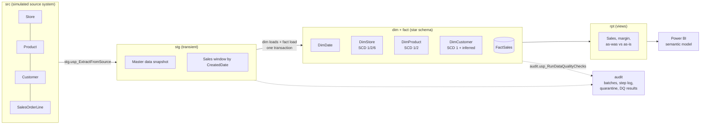
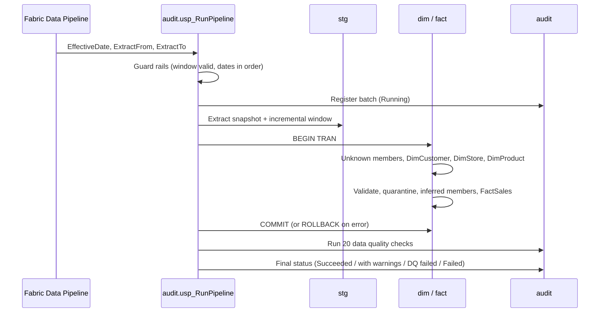
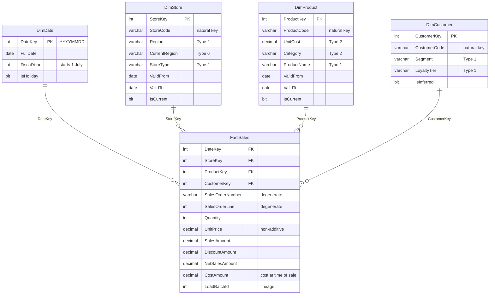

# Contoso Retail Dimensional Model on Microsoft Fabric

A production-style star schema and incremental load pipeline built in a **Microsoft Fabric Warehouse** with T-SQL. It models retail sales across stores, products, customers and time, handles slowly changing dimensions properly (Types 1, 2 and 6), and protects itself with idempotent loads, quarantine, inferred members and an automated data quality suite.

> **Origin:** this project started from the Microsoft Learn lab [*Design and implement a dimensional model*](https://microsoftlearning.github.io/mslearn-fabric/Instructions/Labs/26-design-dimensional-models.html). The lab hand-writes a star schema and simulates SCD changes with one-off `UPDATE` and `INSERT` statements. This repository rebuilds it as a repeatable, testable pipeline. See [What I added beyond the lab](#what-i-added-beyond-the-lab).


---

## Business problem

Contoso Retail wants to analyse sales performance by store, product, customer and period, and needs those numbers to stay **historically accurate** when master data changes:

- When a product's cost rises, past margin must still reflect the cost at the time of each sale.
- When a store moves to a new sales region, leadership wants to see results both **as they were reported at the time** and **restated under today's structure**.
- Sales sometimes arrive late, reference customers the CRM has not sent yet, or contain errors. None of that should break the load or silently distort totals.

## Architecture



A single orchestrator, `audit.usp_RunPipeline`, runs a batch end to end and can be scheduled from a Fabric Data Pipeline (Stored procedure activity).



## Star schema



**Grain:** one row per sales order line. Full column-level detail and the SCD attribute matrix are in [docs/data-dictionary.md](docs/data-dictionary.md).

## What I added beyond the lab

| Area | Original lab | This project |
|---|---|---|
| Structure | Five tables in `dbo` | Layered `src → stg → dim/fact → rpt` schemas plus `audit` |
| Loading | Hand-written `INSERT` statements | Parameterised stored procedures driven by one orchestrator |
| Data volume | 10 sales rows | 2,471 deterministic synthetic lines, reproducible on every run |
| SCD Type 2 | One manual expire-and-insert | Generic change detection on Type 2 attributes, same-day correction handling, half-open validity windows |
| SCD Type 6 | Not covered | `CurrentRegion` on every store version for "as was" versus "as is" reporting |
| Fact lookups | Keys typed by hand | Point-in-time surrogate key lookup on the order date |
| Late-arriving facts | Not covered | February sales loaded in March bind to February's cost and region |
| Early-arriving facts | Not covered | Inferred customer members, completed in place when the CRM record arrives |
| Bad data | Not covered | Validation rules and an `audit.RejectedSalesLine` quarantine table |
| Missing references | Not covered | Unknown members (key `-1`) so totals stay complete |
| Re-runs | Would duplicate data | Idempotent delete-and-insert by order line, proven by a rerun test |
| Integrity | Constraints `NOT ENFORCED`, unchecked | 20 automated data quality checks per batch |
| Margin | Not possible | `CostAmount` captured at load from the SCD Type 2 cost version |
| Date dimension | 6 hard-coded rows | Generated 2025 to 2027, fiscal calendar, US holidays incl. floating ones |
| Operations | None | Batch control, step-level row counts, run history view, ordering guard rails |
| Consumption | Ad hoc queries | Reporting views and a Power BI semantic model with DAX measures |

## Results

Screenshots from my own Fabric trial run. Each step and its expected output is in the [runbook](docs/runbook.md).

| | |
|---|---|
| **SCD Type 2 product history**: Mountain Bike Pro and Road Bike Elite each carry two cost versions; the Water Bottle rename is a Type 1 overwrite<br/> | **Historical accuracy**: February sales, including two that arrived late, keep the $1,200 cost; March onwards use $1,350<br/> |
| **As was versus as is**: Austin's January and February revenue stays in Central under Type 2 and moves to South under Type 6<br/> | **Data quality suite**: 20 checks per batch, errors versus warnings<br/> |
| **Idempotency test**: replaying batch 2 changes nothing<br/> | **Power BI report** on the semantic model<br/> |

## Repository structure

```
├── sql/
│   ├── 01_setup/          schemas, source, staging, dimension, fact, audit tables, constraints
│   ├── 02_seed/           source master data and deterministic synthetic sales
│   ├── 03_procedures/     date build, unknown members, extract, dimension loads, fact load, DQ, orchestrator
│   ├── 04_reporting/      rpt views for analysts and Power BI
│   ├── 05_run/            batch 1, source changes, batch 2, rerun test, inferred member, guard-rail tests
│   ├── 06_analysis/       star schema, SCD validation and business insight queries
│   └── 99_maintenance/    full reset
├── powerbi/measures.dax   DAX measures for the semantic model
├── scripts/deploy.py      optional one-command deployment from a local machine
├── docs/                  runbook, design decisions, data dictionary, semantic model, screenshots, interview guide
└── screenshots/           images referenced by this README
```

Every `.sql` file contains exactly one batch, so it can be pasted into the Fabric SQL editor and run as is, or executed by `deploy.py` in order.

## How to run it

**Prerequisites:** a Microsoft Fabric trial or paid capacity.

1. Create a workspace on trial capacity and a Warehouse named `ContosoDW`.
2. Run every script in `sql/01_setup`, `sql/02_seed`, `sql/03_procedures` and `sql/04_reporting` in file order.
3. Run the scenarios in `sql/05_run` in order, checking the expected results noted at the top of each file.
4. Explore with `sql/06_analysis`, then build the semantic model described in [docs/semantic-model.md](docs/semantic-model.md).

Prefer the command line? `python scripts/deploy.py --server <sql-endpoint> --database ContosoDW --run-demo` deploys everything and runs the scenarios.

The full walkthrough, including the Data Pipeline schedule and where to take each screenshot, is in [docs/runbook.md](docs/runbook.md).

## Key design decisions

The reasoning behind each choice is written up in [docs/design-decisions.md](docs/design-decisions.md). In short:

- **Constraints are metadata, checks are enforcement.** Fabric Warehouse constraints are `NOT ENFORCED`; they exist so Power BI detects relationships. Integrity is guaranteed by the load logic and verified by the DQ suite.
- **Half-open validity windows** (`ValidFrom <= date < ValidTo`) remove off-by-one ambiguity at version boundaries.
- **First versions start at 1900-01-01**, so any historical or late-arriving sale always resolves to a version.
- **One transaction per batch** keeps the star schema consistent if any step fails.
- **Cost is snapshotted onto the fact** at load time, so margin reports stay fast and correct without date-range joins.
- **Unknown versus inferred members** are different tools: Unknown (`-1`) for references that will never resolve, inferred for ones that will.

## Tech stack

Microsoft Fabric Warehouse · T-SQL (stored procedures, views, set-based SCD logic) · Fabric Data Pipelines · Power BI semantic model and DAX · Python (`pyodbc`, Entra ID authentication) · Mermaid

## Possible extensions

- Land the source data as Delta tables in a Lakehouse (bronze) and read them through the SQL analytics endpoint.
- Replace the `UPDATE`/`INSERT` pairs with `MERGE` and benchmark the difference.
- Add an accumulating snapshot fact for order fulfilment, and a store-day periodic snapshot.
- Deploy through Fabric Git integration and deployment pipelines (dev, test, prod).
- Add row-level security on region in the semantic model.

## Author

**Emmanuel** · Data Analyst and BI Developer moving into data engineering on the Azure and Fabric stack.

## Licence

MIT. The original lab content belongs to Microsoft and is linked, not reproduced.
